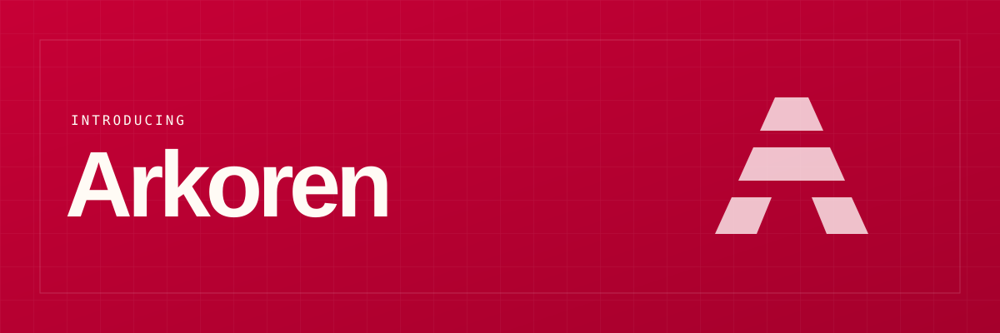

# Arkoren



A modular Go toolkit for the work that keeps coming back: handling requests,
validating input, querying databases, running background jobs, and understanding
what happened along the way.

[Documentation](cmd/arkoren/skills/arkoren/references/guides/about/introduction.md) ·
[Quickstart](cmd/arkoren/skills/arkoren/references/guides/first-steps/quickstart.md) ·
[Introducing Arkoren](website/src/content/blog/introducing-arkoren.mdx)

## A toolkit, not a framework

Use one package in an existing application or combine them to build a service.
Arkoren builds on `net/http`, `log/slog`, and `context.Context`. You construct
objects and connect them explicitly—no dependency injection container, automatic
discovery, or required application lifecycle.

## The pieces you need

- **HTTP:** routing, error-returning handlers, request and response helpers,
  authentication, sessions, and middleware.
- **Data:** parameterized SQL and schema builders, database access, pagination,
  validation, and standard Problem Details error responses.
- **Services:** cache, queues, mail, push notifications, storage, payments and provider-managed
  subscriptions, workflows, scheduling, feature flags, search, and language models.
- **MCP:** typed application tools, explicitly served through an optional
  [MCP protocol adapter](cmd/arkoren/skills/arkoren/references/guides/mcp/tools.md).
- **Operations:** optional startup and shutdown coordination, health checks,
  traces, metrics, and local diagnostic MCP tools.

The core has no third-party dependencies. Foundation libraries for collections,
SQL queries, cryptographic keys, TLS certificates, validation, and Problem Details also work independently of Arkoren
and use only the standard library.

[Application keys](cmd/arkoren/skills/arkoren/references/guides/keys/overview.md) use
validated immutable shared keys, ECDSA P-256 signing identities, and X25519
exchange identities. Provision them offline with `arkoren key generate` and load the same
material at startup; the CLI never overwrites an established key.

[TLS certificates](cmd/arkoren/skills/arkoren/references/guides/http-networking/certificates.md)
support local CA provisioning, existing client and server identities, and native
Go TLS configuration. The offline
[certificate commands](cmd/arkoren/skills/arkoren/references/guides/cli/certificates.md)
create files without overwriting them; system root trust changes require a
separate, explicit command.

## Choose your infrastructure

Write against shared service interfaces, then choose a driver for Redis,
PostgreSQL, S3, RabbitMQ, or another supported backend. Drivers live in separate
Go modules, so you add only the integrations you need. Native clients remain
accessible when you need vendor-specific features.

[Push notifications](cmd/arkoren/skills/arkoren/references/guides/push/overview.md) start with
standard Web Push for supported browsers, including Home Screen web apps on
iOS and iPadOS. Your application owns subscriptions and notification display;
the driver handles encrypted submission without automatic retries.

[Payments](cmd/arkoren/skills/arkoren/references/guides/payments/drivers.md) include hosted
checkout through Stripe, PayPal, and Mollie. For native apps, the
[mobile payments guide](cmd/arkoren/skills/arkoren/references/guides/payments/mobile-payments.md)
shows shared payment preparation for Stripe cards and eligible wallets or
PayPal SDK orders, with provider-required completion and server-side outcome
verification.

Vendor modules also provide HTTP adapters, including
[CAPTCHA verification](cmd/arkoren/skills/arkoren/references/guides/abuse-prevention/captcha.md)
for Cloudflare Turnstile and Google reCAPTCHA. These keep provider-specific
tokens and risk policies explicit rather than impose a shared service contract.
[Webhook adapters](cmd/arkoren/skills/arkoren/references/guides/http-capabilities/webhooks.md#provider-adapters)
receive notifications from Stripe, PayPal, Resend, Mailgun, Postmark, and OpenAI;
your application chooses handlers and acceptance policy.

Many services include in-memory drivers for local development and tests. Every
contract has a conformance test suite to check that its drivers behave consistently.

## Get started

Arkoren requires **Go 1.27 or later**. Follow the
[installation guide](cmd/arkoren/skills/arkoren/references/guides/first-steps/installation.md)
to install the modules you need, then the
[quickstart](cmd/arkoren/skills/arkoren/references/guides/first-steps/quickstart.md) to build
your first HTTP service.

Focused documentation snippets show the success path and keep error results
visible. In application code, check those errors before using the results.

Working with a coding agent? Install the documentation skill:

```sh
go install arkoren.dev/cmd/arkoren@latest
arkoren skills install
```

Run the second command from your project root after adding Go's binary directory
to `PATH`. It installs the CLI's bundled documentation in `.agents/skills/arkoren/`
without contacting a server. The [agent guide](cmd/arkoren/skills/arkoren/references/guides/agent-skills/working-with-agents.md)
covers discovery, version selection, safe updates, and installation with
`gh skill` or `npx skills` without the Arkoren CLI. The website and skill share
the same guides. API declarations are published on pkg.go.dev.

## Contribute

Run `make` for the shared local and CI commands. For example, `make test
MODULE=core PKG=./http/...` runs cached short tests; `make check MODULE=core`
runs lint and cached short race tests. Go commands run with `GOWORK=off` so
each module verifies its own requirements. Race targets enable CGO only for
their test command and require a C compiler.

Use `make integration MODULE=driver/redis` for service-backed tests. It waits
for healthy Compose services and removes its unique test project's containers
and volumes on exit. An explicit `COMPOSE_PROJECT_NAME` is honored and that
project must be disposable. Manual `services`/`cleanup` commands instead share
the named `arkoren-manual-driver-redis` project by default. Fixed test ports
must still be free. Integrations use `-count=1`; ordinary module tests retain
caching. After guide edits, run `make generate` and `make docs` (install website
dependencies and Playwright Chromium first). Workflow edits also require
`make workflow-check`; execution of GitHub workflows is verified in CI, not
through a local workflow emulator.

The website build checks guide-index freshness without writing and validates
guide metadata. Module conventions and offline source links are reviewed rather
than checked by a repository-wide Go policy suite.

## License

[MIT](LICENSE).
